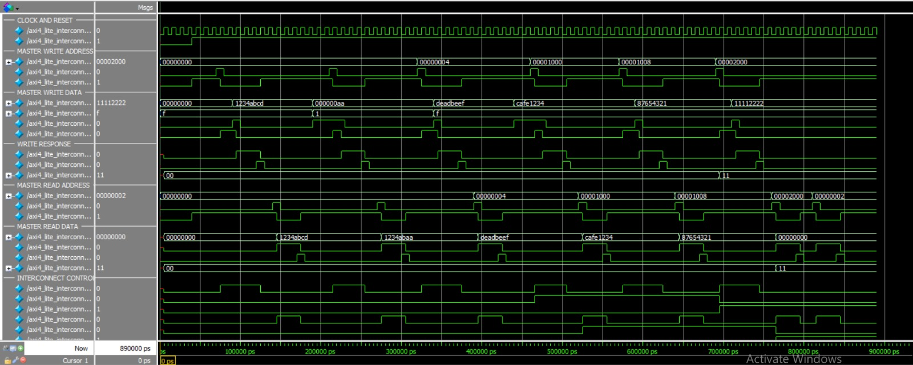
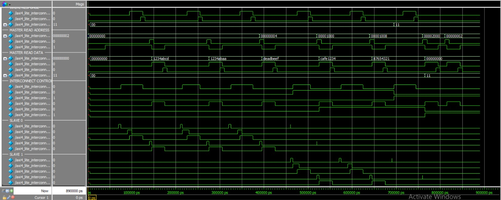

# AXI4-Lite-1M-2S-Interconnect
Verilog HDL-based AXI4-Lite 1-Master / 2-Slave Interconnect featuring address decoding, five-channel communication, VALID/READY handshaking, byte-strobe write support, and error response handling. Verified using ModelSim simulation.
# AXI4-Lite 1-Master / 2-Slave Interconnect using Verilog HDL


---

## About the Project

This project implements an **AXI4-Lite Interconnect connecting one master to two slave peripherals** using Verilog HDL.

The interconnect manages communication between the master and two memory-mapped register-based slave devices through address decoding and channel routing.

The design supports read and write transactions, AXI VALID/READY handshaking, byte-level write operations, response handling, and error detection for invalid and unaligned addresses.

The complete RTL design is functionally verified using ModelSim.

## Architecture

The architecture consists of:

- **1 AXI4-Lite Master:** Generates read and write requests.
- **1 AXI4-Lite Interconnect:** Routes transactions based on decoded addresses.
- **2 AXI4-Lite Slaves:** Independent register-based peripherals.
- **Address Decoder:** Identifies the target slave and detects invalid addresses.

### Block Diagram

```text
                  AXI4-Lite MASTER
                         |
                         |
               AXI4-Lite INTERCONNECT
                         |
                  ADDRESS DECODER
                    /         \
                   /           \
                  /             \
             SLAVE 0           SLAVE 1
           Register Bank     Register Bank
```

## Address Mapping

| Slave | Address Range | Description |
|---|---|---|
| Slave 0 | `0x00000000 – 0x00000FFF` | First register-based slave |
| Slave 1 | `0x00001000 – 0x00001FFF` | Second register-based slave |

Address decoding is performed using address bit 12 for selecting the two supported address windows.

Addresses outside the supported ranges and unaligned accesses are handled with error responses.

## AXI4-Lite Channel Architecture

AXI4-Lite uses five independent channels for read and write transactions.

| Channel | Main Signals | Function |
|---|---|---|
| Write Address | AWADDR, AWVALID, AWREADY | Transfers write address |
| Write Data | WDATA, WSTRB, WVALID, WREADY | Transfers write data and byte enables |
| Write Response | BRESP, BVALID, BREADY | Returns write status |
| Read Address | ARADDR, ARVALID, ARREADY | Transfers read address |
| Read Data | RDATA, RRESP, RVALID, RREADY | Returns read data and status |

## Key Features

- AXI4-Lite 1-Master / 2-Slave architecture.
- Address-based slave selection.
- Independent read and write channel handling.
- Write address and write data routing.
- Read address and read data routing.
- VALID/READY handshake implementation.
- Byte-enable write support using WSTRB.
- Separate register banks for both slaves.
- Read and write response generation.
- Invalid address detection.
- Unaligned address error handling.
- Modular RTL architecture.
- Functional verification using ModelSim.

## RTL Modules

| RTL Module | Description |
|---|---|
| `axi4_lite_interconnect.v` | Main interconnect that routes master transactions to the selected slave. |
| `axi4_lite_slave.v` | Implements register-based slave functionality with read and write operations. |
| `axi4_lite_address_decoder.v` | Decodes addresses and identifies the target slave or invalid address. |

## Working Principle

### 1. Write Transaction

1. Master generates a write address through the AW channel.
2. Interconnect decodes the address.
3. The selected slave is activated.
4. Write data is transferred through the W channel.
5. WSTRB determines which byte lanes are updated.
6. Slave generates a write response through the B channel.
7. Interconnect forwards the response to the master.

### 2. Read Transaction

1. Master sends a read address through the AR channel.
2. Interconnect decodes the address.
3. The selected slave receives the read request.
4. Slave accesses the corresponding register.
5. Read data is returned through the R channel.
6. Interconnect forwards the read response to the master.

### 3. Invalid Address Handling

- Interconnect checks whether the requested address belongs to a supported slave address range.
- Invalid and unaligned accesses are rejected.
- The master receives an error response.

## Response Codes

| Response | Code | Description |
|---|---|---|
| OKAY | `2'b00` | Successful transaction |
| DECERR | `2'b11` | Decode error / invalid address |

## Project Directory Structure

```text
AXI4-Lite-1M-2S-Interconnect/
│
├── rtl/
│   ├── axi4_lite_interconnect.v
│   ├── axi4_lite_slave.v
│   └── axi4_lite_address_decoder.v
│
├── tb/
│   └── axi4_lite_interconnect_tb.v
│
├── sim/
│   └── run.do
│
├── results/
│   ├── axi4_lite_master_interconnect.png
│   └── axi4_lite_slave_channels.png
│
└── README.md
```

## Simulation and Verification

The design is verified using a Verilog testbench in ModelSim.

The testbench covers the following scenarios:

| Test Case | Expected Result | Status |
|---|---|---|
| Slave 0 write/read at `0x00000000` | `1234ABCD` | PASS |
| Byte strobe write | `1234ABAA` | PASS |
| Slave 0 write/read at `0x00000004` | `DEADBEEF` | PASS |
| Slave 1 write/read at `0x00001000` | `CAFE1234` | PASS |
| Slave 1 write/read at `0x00001008` | `87654321` | PASS |
| Invalid write at `0x00002000` | BRESP = `11` | PASS |
| Invalid read at `0x00002000` | RRESP = `11` | PASS |
| Unaligned read at `0x00000002` | RRESP = `11` | PASS |

**Verification Result: ALL TEST CASES PASSED**

## Simulation Waveforms

The following waveforms demonstrate the functional verification of the AXI4-Lite 1-Master / 2-Slave Interconnect using ModelSim.

### 1. Master Interface and Interconnect Control

This waveform demonstrates:

- Clock and reset signals.
- Master write address channel.
- Master write data channel.
- Write response channel.
- Master read address channel.
- Master read data channel.
- Interconnect control and slave selection signals.
- Successful and invalid transaction responses.



### 2. Slave Interface and Transaction Routing

This waveform demonstrates:

- Slave 0 write and read transactions.
- Slave 1 write and read transactions.
- Slave VALID signal activity.
- Independent slave selection.
- Address-based transaction routing.
- Read and write response behavior.



## How to Run the Project

### Step 1: Open ModelSim

Navigate to the project root directory.

### Step 2: Execute the Simulation Script

```tcl
do sim/run.do
```

### Step 3: Start Simulation

If the script compiles the RTL and testbench but does not launch simulation:

```tcl
vsim -gui work.axi4_lite_interconnect_tb
```

### Step 4: Add Waveforms

```tcl
add wave -r /*
```

### Step 5: Run the Testbench

```tcl
run -all
```

The transcript should display the transaction results and:

```text
===== ALL TESTS PASSED =====
```

## Tools and Technologies

- **Verilog HDL** – RTL design and implementation.
- **AXI4-Lite Protocol** – Memory-mapped communication interface.
- **ModelSim** – Functional simulation and waveform analysis.
- **Digital Logic Design** – Address decoding and control logic.
- **Git and GitHub** – Version control and project documentation.

## Learning Outcomes

- Understanding AXI4-Lite protocol architecture.
- Implementing five-channel AXI communication.
- Designing master-to-multiple-slave interconnects.
- Understanding VALID/READY handshaking.
- Implementing address decoding and slave selection.
- Handling byte-level write operations using WSTRB.
- Understanding AXI read and write response codes.
- Developing modular RTL using Verilog HDL.
- Functional verification and waveform debugging using ModelSim.

## Future Improvements

- Support multiple outstanding transactions.
- Extend the interconnect to support additional slave peripherals.
- Implement arbitration for multiple masters.
- Integrate AXI4-Lite peripherals with a RISC-V processor.
- Perform synthesis and timing analysis.

---

**Project Domain:** VLSI | RTL Design | AMBA Protocols | AXI4-Lite | Verilog HDL
